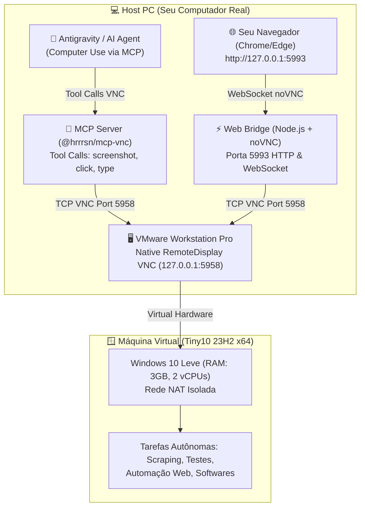

# 🪟 Windows VM para Antigravity & AI Computer Use

> **Ambiente seguro, isolado e de alta performance para agentes de inteligência artificial operarem o Windows via Computer Use (VNC), com acompanhamento visual em tempo real diretamente pelo navegador do PC hospedeiro.**

---

## 💡 A Ideia & O Conceito

Quando usamos agentes de IA com capacidade de **Computer Use** (como o **Google Antigravity**, **Claude Computer Use**, **Agent Zero** ou **Open Interpreter**), controlar a máquina física principal traz sérios problemas:
- ❌ **Perda de foco:** O mouse e o teclado ficam se movendo sozinhos, impedindo a pessoa de trabalhar.
- ❌ **Risco de segurança:** O agente pode acidentalmente fechar abas do trabalho, clicar em arquivos confidenciais ou alterar configurações do sistema operacional.
- ❌ **Instabilidade:** Popups e notificações do computador real podem quebrar o fluxo visual do agente.

### 🌟 A Solução Criada
Criamos uma **Máquina Virtual Windows (Tiny10 x64)** ultra-leve que roda em segundo plano (*headless*) no **VMware Workstation**, controlada pelo Antigravity através de uma arquitetura limpa em camadas:

1. **Zero Agentes no Guest (Segredo Técnico):** Não é necessário instalar software VNC pesado ou scripts dentro do Windows virtual. O próprio hypervisor do VMware Workstation possui um servidor VNC nativo (`RemoteDisplay.vnc`), que espelha os pixels diretamente da placa de vídeo virtual para a porta local `127.0.0.1:5958`.
2. **Controle Autônomo da IA via MCP:** O Antigravity se conecta via protocolo **MCP (Model Context Protocol)** e enxerga a tela da VM em alta definição, clicando e digitando de forma cirúrgica.
3. **Visualizador em Tempo Real no Navegador do PC:** Um bridge Node.js super rápido conecta um servidor HTTP/WebSocket (`noVNC`) ao VNC da VM. Você abre uma aba comum no seu Chrome/Edge (`http://127.0.0.1:5993`) e assiste à IA trabalhando em tempo real, com zero sobrecarga e redimensionamento automático!

---

## 📐 Arquitetura do Sistema



---

## ⚡ Por que Tiny10 (Windows 10 Otimizado)?

O **Tiny10** (desenvolvido pelo projeto *NTDEV*) é uma versão enxuta do Windows 10 baseada na compilação 23H2:
- **Consumo mínimo:** Usa menos de 1 GB de memória RAM em repouso.
- **Sem bloatware:** Sem anúncios, sem jogos pré-instalados, sem Cortana ou telemetria invasiva.
- **Compatibilidade total:** Suporta qualquer binário Windows (`.exe`, `.msi`), navegadores modernos, Edge WebView2, Node.js e scripts PowerShell.
- **Tamanho compacto:** O disco virtual ocupa apenas uma fração de um Windows tradicional.

---

## 📥 Como Baixar os Componentes (Sem Subir Gigabytes no Git)

Em vez de armazenar arquivos `.vmdk` ou ISOs gigantescas de 20 GB neste repositório, você pode reproduzir a VM completa com os scripts e links abaixo:

### 1. VMware Workstation Pro (Gratuito)
A Broadcom liberou o VMware Workstation Pro **100% gratuito para uso pessoal**.
- [Download Oficial VMware Workstation Pro](https://www.vmware.com/products/desktop-hypervisors/workstation-and-fusion.html)

### 2. ISO do Tiny10 23H2 (x64)
O Tiny10 é hospedado oficialmente no **Internet Archive** pelo próprio criador (NTDEV):
- **Página oficial do projeto:** [Internet Archive - Tiny10 NTDEV](https://archive.org/details/tiny-10-NTDEV)
- **Download direto da ISO:** `tiny10 23h2 x64.iso` (~3.5 GB)

#### 🚀 Download Automático via PowerShell:
Basta executar o script incluído neste repositório:
```powershell
powershell -ExecutionPolicy Bypass -File .\scripts\download_tiny10.ps1
```

### 3. Node.js (Ambiente do Host)
Necessário no PC hospedeiro para executar o bridge web e os servidores MCP:
- [Download do Node.js LTS](https://nodejs.org/)

---

## 🛠️ Como Montar a VM Passo a Passo

### Passo 1: Criar a Máquina no VMware
1. Abra o VMware Workstation e clique em **Create a New Virtual Machine**.
2. Selecione **Typical** e selecione a ISO baixada (`tiny10_x64_23h2.iso`).
3. Defina o sistema como **Windows 10 x64**.
4. Configure as especificações recomendadas:
   - **Memória RAM:** 3072 MB (3 GB) ou 4096 MB (4 GB).
   - **Processadores:** 2 cores.
   - **Disco rígido:** 40 GB a 60 GB (em arquivo único ou split, expansível).
   - **Rede:** NAT (`ethernet0.virtualDev = "e1000"`).
   - **Firmware:** EFI.

### Passo 2: As Linhas Mágicas no Arquivo `.vmx`
Com a VM desligada, abra o arquivo `Tiny10.vmx` em um editor de texto (ou use o template pronto em `templates/Tiny10.vmx`) e adicione as seguintes linhas ao final do arquivo:

```ini
# Habilita o servidor VNC nativo embutido no hypervisor
RemoteDisplay.vnc.enabled = "TRUE"
RemoteDisplay.vnc.port = "5958"
RemoteDisplay.vnc.ip = "127.0.0.1"
RemoteDisplay.vnc.keyMap = "us"

# Otimizacao de placa de rede para compatibilidade no Tiny10
ethernet0.virtualDev = "e1000"
```

> [!IMPORTANT]
> A configuração `RemoteDisplay.vnc.ip = "127.0.0.1"` garante que a porta VNC fique acessível **exclusivamente no seu computador local**, impedindo qualquer acesso externo não autorizado pela rede local.

---

## 🌐 Visualizador Web em Tempo Real (noVNC)

Para assistir o agente de IA operando a VM direto no seu navegador sem abrir o VMware:

```powershell
powershell -ExecutionPolicy Bypass -File .\scripts\start_viewer.ps1
```

Esse script irá:
1. Instalar as dependências do Node.js (`ws`).
2. Baixar a biblioteca estática do `noVNC` caso ainda não exista.
3. Abrir automaticamente a aba no seu navegador:
   ```
   http://127.0.0.1:5993/vnc.html?autoconnect=1&resize=scale&path=websockify
   ```

---

## 🤖 Conectando com o Antigravity / MCP

Adicione a configuração do servidor MCP no arquivo de configuração do seu agente (`mcp_config.json` ou similar):

```json
{
  "mcpServers": {
    "tiny10-vnc": {
      "command": "node",
      "args": ["C:/Users/SEU_USUARIO/caminho/windows-vm-antigravity-computer-use/node_modules/@hrrrsn/mcp-vnc/dist/index.js"],
      "env": {
        "VNC_HOST": "127.0.0.1",
        "VNC_PORT": "5958"
      }
    }
  }
}
```

### Ferramentas VNC Disponíveis para o Agente:
- `vnc_screenshot`: Captura o frame atual da tela em alta resolução para visão computacional do modelo.
- `vnc_click`: Executa clique do mouse com coordenadas `x` e `y` precisas.
- `vnc_type_text`: Digita textos, senhas ou URLs na janela em foco.
- `vnc_key_press`: Envia teclas de atalho como `Ctrl+c`, `Alt+F4`, `Enter`, `Super/Win`.

---

## 🎮 Comandos Úteis do VMware via Linha de Comando (`vmrun`)

O VMware acompanha o utilitário `vmrun.exe`, permitindo automação total sem interface gráfica:

```powershell
# Definir caminho do vmrun
$vmrun = "C:\Program Files (x86)\VMware\VMware Workstation\vmrun.exe"
$vmx = "$env:USERPROFILE\Documents\Virtual Machines\Tiny10\Tiny10.vmx"

# 1. Iniciar a VM de forma silenciosa (Headless / Em segundo plano)
& $vmrun -T ws start $vmx nogui

# 2. Listar VMs atualmente em execução
& $vmrun -T ws list

# 3. Criar um Snapshot de segurança (estado limpo)
& $vmrun -T ws snapshot $vmx "Estado Limpo"

# 4. Restaurar a VM instantaneamente para o Snapshot limpo
& $vmrun -T ws revertToSnapshot $vmx "Estado Limpo"

# 5. Desligar a VM
& $vmrun -T ws stop $vmx soft
```

---

## ⚖️ Comparativo: Controle na Máquina Real vs. VM com VNC

| Recurso | Computer Use na Máquina Real | VM Isolada Tiny10 + VNC Nativo |
| :--- | :--- | :--- |
| **Uso simultâneo do PC** | ❌ Impossível (mouse preso) | ✅ Livre para trabalhar normalmente |
| **Segurança do sistema host** | ⚠️ Risco de cliques indevidos | 🛡️ Isolamento total em sandbox |
| **Consumo de recursos** | Alto impacto na máquina de trabalho | ⚡ Apenas ~1 GB de RAM e 2 vCPUs |
| **Visualização ao vivo** | Nenhuma (janelas competindo) | 🌐 Aba suave no navegador via noVNC |
| **Restauração em 1 segundo** | ❌ Não existe | ✅ Revert to Snapshot com 1 comando |
| **Agentes extras no Guest** | Exige instalação de software | 🌟 Zero agentes (Hypervisor cuida de tudo) |

---

## 📂 Estrutura do Repositório

```
windows-vm-antigravity-computer-use/
├── .gitignore               # Ignora ISOs, VMDKs pesados e logs
├── LICENSE                  # Licença MIT
├── README.md                # Documentação completa de engenharia reversa
├── mcp/
│   ├── package.json         # Dependências do servidor MCP
│   └── server.mjs           # Servidor MCP para controle headless via Antigravity
├── scripts/
│   ├── download_tiny10.ps1  # Script para baixar a ISO oficial do Tiny10
│   ├── setup_vm.ps1         # Verificador de ambiente (VMware, Node, VMX)
│   └── start_viewer.ps1     # Inicia o noVNC e abre a aba do navegador
├── templates/
│   └── Tiny10.vmx           # Template limpo do arquivo de configuração do VMware
└── viewer/
    ├── bridge.mjs           # Servidor HTTP + WebSocket Websockify
    └── package.json         # Dependências do visualizador (ws)
```

---

## 👤 Autora & Créditos

- **Autora:** Kethely Soriano ([@kethysb](https://github.com/kethysb))
- **Tiny10:** Criado e mantido por [NTDEV](https://twitter.com/NTDEV_)
- **noVNC:** Projeto open source [noVNC](https://github.com/novnc/noVNC)
- **Desenvolvido com:** [Google Antigravity AI](https://deepmind.google/)
